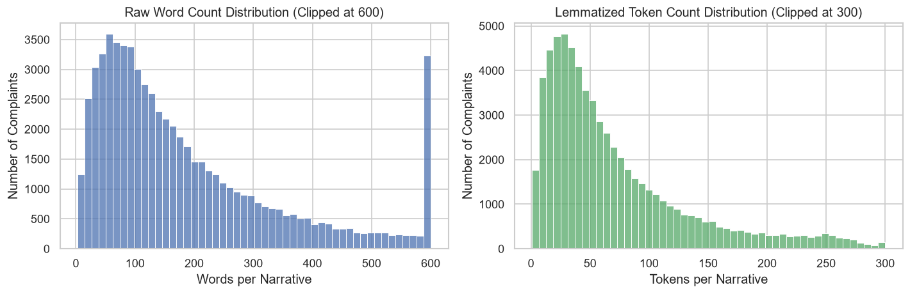
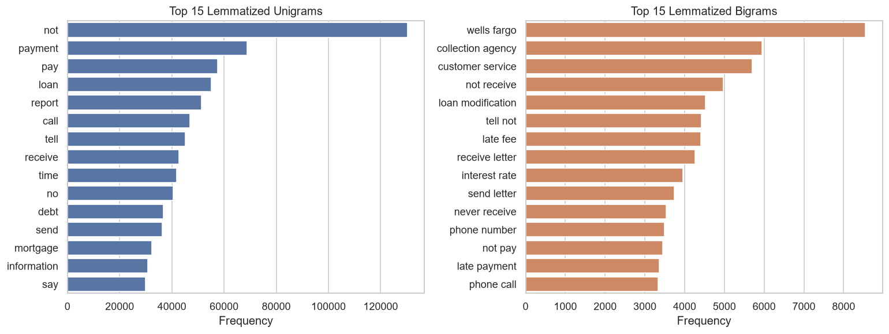
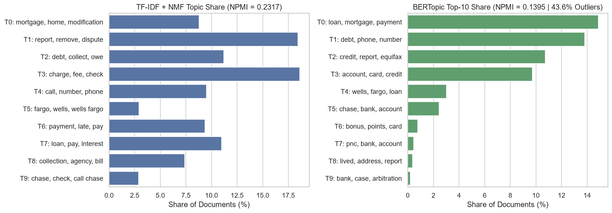
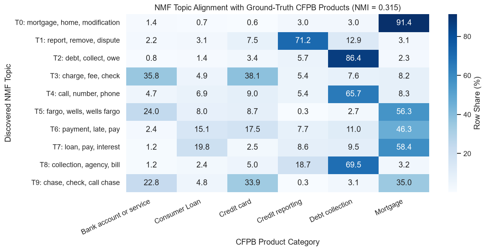

## Project Structure

    Project_complaints/
    ├── data/                        # Raw CFPB dataset (git-ignored)
    ├── notebooks/
    │   ├── 01_setup_and_eda.ipynb                 # Corpus audit, length compression & n-gram EDA
    │   └── 02_topic_modeling_comparison.ipynb     # Prevalence charts & product alignment heatmap
    ├── results/
    │   ├── eda_length_distribution.png            # Raw vs. lemmatized token distribution
    │   ├── eda_top_products.png                   # Top 10 CFPB product categories
    │   ├── eda_top_ngrams.png                     # Top 15 unigrams & bigrams
    │   ├── topic_prevalence_comparison.png        # NMF vs. BERTopic topic share comparison
    │   ├── nmf_product_alignment_heatmap.png      # NMF topics vs. ground-truth products (NMI = 0.315)
    │   ├── topic_comparison_summary.csv           # Extracted top words & shares for all 20 topics
    │   └── model_metrics.csv                      # Quantitative NPMI coherence benchmark
    ├── src/
    │   ├── preprocess.py                          # Text cleaning, redaction removal & spaCy lemmatization
    │   └── topics.py                              # TF-IDF + NMF, BERTopic & pure-NumPy NPMI evaluation
    ├── requirements.txt
    └── README.md

---

## Visualizations

### 1. Corpus Exploration & Preprocessing Impact

### 2. Model Comparison & Ground-Truth Alignment

---

## Reproducibility

    # 1. Create and activate virtual environment
    python -m venv .venv
    .\.venv\Scripts\Activate.ps1

    # 2. Install dependencies & spaCy English model
    pip install -r requirements.txt
    python -m spacy download en_core_web_sm

    # 3. Run preprocessing (generates results/complaints_clean.csv)
    python src/preprocess.py

    # 4. Run comparative topic modeling & coherence scoring
    python src/topics.py